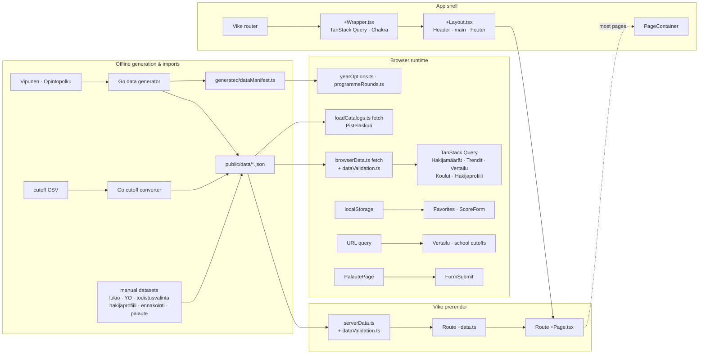

# Frontend

The frontend contains the website's pages, components and hooks. It uses React 19, TypeScript, Vike and Chakra UI. Vike prerenders the routes into a static site, which fetches the committed JSON files from `public/data/`.

### Requirements

- Node.js
- pnpm 11

### Quick start

```sh
pnpm install
pnpm run dev
```

Open `http://localhost:3000`.

### Commands

```sh
pnpm run dev                     # Start the development server
pnpm run lint                    # Run the score calculation tests, TypeScript, Biome and Deslop
pnpm run build                   # Generate the sitemap and build the static site
pnpm run preview                 # Preview the production build
pnpm run test:unit               # Run the score calculation tests
pnpm run test:component          # Run Vitest component and hook tests
pnpm run test:component:coverage # Component-test coverage report
pnpm run test:e2e                # Run the Playwright smoke tests
pnpm run format                  # Format the src directory with Biome
pnpm run deslop                  # Check for AI slop patterns with Deslop
pnpm run deslop:fix              # Fix auto-fixable Deslop findings and format src
pnpm run deslop:baseline         # Update the Deslop baseline
```

The backend tools write the generated frontend datasets into `public/data/`. Tygo generates `src/types.gen.ts` and `src/types/pisterajat.gen.ts`, while the data generator updates `src/generated/dataManifest.ts`. Do not edit these files by hand.

Additional static datasets in `public/data/` are maintained separately from the main Vipunen/Opintopolku generator:
- `pisterajat/pisterajat-<year>-<season>-<sector>.json` – higher-education admission cutoffs (`amk` and `yliopisto`)
- `pisterajat/lukio/lukio-keskiarvot-2026.json` – upper secondary school admission averages
- `pisterajat/yo-kirjotukset/yo-pisterajat-*.json` – matriculation exam grade boundaries
- `todistusvalinta/*-2026.json` – scoring models, threshold rules and programme crosswalk for `/pistelaskuri/`
- `hakijaprofiili/hakijaprofiili-*.json` – applicant age and gender distributions
- `ennakointi/koulutustarpeet.json` – education-need forecasts
- `opiskelijapalaute/{yliopisto,amk}-palaute.json` – Kandipalaute and AVOP survey summaries

### WebMCP

`useWebMCP` from `use-webmcp-tool` registers `calculate_todistuspisteet` on `/pistelaskuri/`. The hook no-ops where `document.modelContext` is missing. The call site lives in that route `+Page.tsx` file.

The `execute` handler computes with `recalculateFromGrades`, then `setState` so the UI matches. Drop the package if the page stops exposing the tool, or if the WebMCP spec lands and the hook lags.

See [`../backend/README.md`](../backend/README.md) for the data update commands.

### Architecture

#### App shell and data flow



#### Routes and main components

`:slug`, `:ala` and `:kunta` are the URL forms of Vike's `@slug`, `@ala` and `@kunta` route folders.

```mermaid
flowchart TB
  subgraph discovery["Browse and analyse"]
    home["/<br/>LandingPage"] --> homeParts["LandingHeadline · HeroButtons · useCountdown<br/>IosInstallTip · QuickLinkTabs · QuickLinkCard"]
    degrees["/koulutukset/<br/>SchoolsListPage"] --> degreeParts["OptionSelect · SearchInput · FilterItem<br/>useFilteredDegrees · SchoolCard · Pagination"]
    stats["/hakijamaarat/<br/>StatsListPage"] --> statsParts["Search and filters · YearControl · SortControl<br/>useFilteredStatistics · DegreeStatsCard · CompareBar · Pagination"]
    stats --> compare["/vertaile/<br/>ComparePage"] --> compareParts["ComparisonTable · ShareButton"]
    trends["/trendit/<br/>TrendsPage"] --> trendParts["YearControl · useTrendsData · TrendCard<br/>TopBarList · ApplicantTotalsChart"]
    profile["/hakijaprofiili/<br/>HakijaprofiiliPage"] --> profileParts["OptionSelect · ScopeControl · SearchInput<br/>useHakijaprofiiliQuery · useFilteredEntities<br/>EntityList · ProfiliDetail"]
    forecast["/ennakointi/<br/>EnnakointiPage"] --> forecastParts["filterAndSortVajeRows · Pagination"]
  end

  subgraph schools["Schools and cutoff scores"]
    schoolIndex["/koulut/<br/>SchoolIndexPage"] --> schoolIndexParts["YearControl · SortControl<br/>useSchoolListStatistics · SchoolListCard"]
    schoolIndex --> school["/koulut/:slug/<br/>SchoolPage"] --> schoolParts["SchoolCard · SchoolStatistics<br/>DegreeStatsCard · Pagination"]
    school --> schoolCutoffs["/koulut/:slug/pisterajat/<br/>CutoffPage"]
    school --> schoolFeedback["/koulut/:slug/opiskelijapalautteet/<br/>FeedbackPage"] --> schoolFeedbackParts["StudentFeedback"]
    schoolCutoffs --> schoolCutoffParts["SearchInput · OptionSelect · SortControl<br/>useFilteredProgrammes · CutoffCard · Pagination"]
    cutoffIndex["/pisterajat/<br/>CutoffIndexPage"] --> fieldCutoffs["/pisterajat/:ala/<br/>AlaCutoffPage"]
    cutoffIndex --> schoolCutoffs
    fieldCutoffs --> fieldCutoffParts["PistelaskuriCta · SchoolProgrammeList"]
    fieldCutoffs --> schoolCutoffs
    lukioIndex["/lukiot/<br/>LukiotPage"] --> lukioIndexParts["SearchInput · OptionSelect · SortControl<br/>useFilteredLukioSchools · LukioSchoolCard · Pagination"]
    lukioIndex -. prerendered SEO pages .-> lukioSchool["/lukiot/:slug/<br/>LukioSchoolPage"]
    lukioIndex --> lukioCities["/lukiot/kaupungit/<br/>LukiotKaupungitPage"] --> lukioCity["/lukiot/kaupungit/:kunta/<br/>LukioKuntaPage"]
    lukioCity --> lukioSchool
    yoCutoffs["/yo-pisterajat/<br/>YoPisterajatPage"] --> yoCutoffParts["SearchInput · OptionSelect · YoPisterajatTable"]
    lukioSchool --> lukioSchoolParts["LukioSchoolCard"]
  end

  subgraph calculator["Score calculator"]
    scorePage["/pistelaskuri/<br/>ScoreCalculatorPage"] --> scoreForm["ScoreForm · calculate_todistuspisteet"]
    scoreForm --> amm["AmmForm · todistusvalinta"]
    scoreForm --> yo["YoForm · yoForm · yoScoring · todistusvalinta"]
    scorePage --> scoreResults["ResultSelect · SearchInput<br/>ScoreResultList · ScoreResultCard"]
  end

  subgraph content["Content, saved items and support"]
    saved["/oma-hakulista/<br/>SavedListPage"] --> savedParts["useFavorites · SchoolCard<br/>ShareButton · hakulistaImage"]
    hakijalle["/hakijalle/<br/>HakijallePage"] --> toolsPage["ToolsPage · QuickLinkCard"]
    opolle["/opolle/<br/>OpollePage"] --> toolsPage
    guides["/oppaat/<br/>GuidesPage"] --> universityGuide["/oppaat/yliopistojen-todistusvalinta/"]
    guides --> amkGuide["/oppaat/ammattikorkeakoulujen-<br/>todistusvalinta/"]
    registry["guides.ts"] --> guides
    registry --> guideLayout["GuideLayout"]
    universityGuide --> guideLayout
    amkGuide --> guideLayout
    guideLayout --> mdx["content.mdx<br/>Callout · GuideAccordion · Chakra Table"]
    install["/asenna/<br/>InstallGuidePage"]
    faq["/ukk/<br/>Accordion"]
    privacy["/tietosuojaseloste/"]
    feedbackPage["/palaute/<br/>PalautePage"]
    errorPage["_error<br/>ErrorPage"]
  end
```


